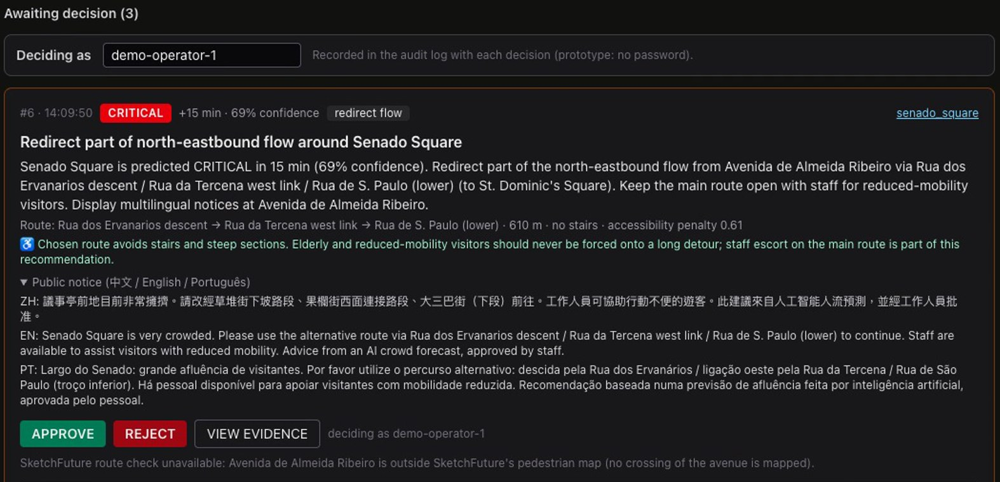

# CrowdPulse Macau

**Phones that count people on the device and send only numbers, crowd forecasts 5–15 minutes ahead with a confidence score, and a named person who approves every action.** A responsible-AI prototype for Macau's historic centre.

Imperial College London Hackathon Hong Kong & Macau 2026 · High School track · Challenge 2(c) Responsible AI (GBA)

<p align="center"></p>

<sub>The Interventions page in the simulated Golden-Week demo: a frame of the video's S04 screen recording (17 Oct 2026; the recording's click indicator removed). The crowd and the forecast are simulated; `demo-operator-1` is a fictional name typed under "Deciding as". Nothing happens until a person approves.</sub>

## At a glance

| | |
|---|---|
| **Real** | The software, end to end: the iOS sensor app (run in the iPhone Simulator on a public-domain street clip), the backend, the forecaster and the operator dashboard with approval and audit log. 124 automated tests pass. Person counting measured on real footage (a CC0 street clip and the 2,000-frame Mall benchmark). The problem facts are public records ([evidence sheet](docs/research/brief-evidence.md)). |
| **Simulated** | The crowd, the forecasting accuracy (held-out days of our own simulator) and the effect of approving a detour. There is no field test in Macau and no partner. |
| **Headline (simulated days)** | +15 min forecasts: macro-F1 **0.865** vs **0.795** for "no change" (persistence); the gain of +0.070 has a 95% interval of +0.049 to +0.089 (paired block bootstrap, [uncertainty summary](experiments/results/uncertainty/summary.md)). Accuracy **96.4%** vs **94.3%**, but a forecast that always says SAFE is already **84.6%** accurate, because most minutes are calm, so F1 is the number we lead with. |
| **Failure case** | In a recorded simulation the crowd built in about 3 minutes, and the first confident CRITICAL forecast came after the true density had crossed CRITICAL: no early warning ([simulation run](experiments/results/simulation_run/README.md)). |
| **Pending (real data)** | The same method on real pedestrian counts from Melbourne street sensors, with the rules committed and pushed before the test days ([pre-registration](experiments/datasets/melbourne/README.md#pre-registered-analysis-committed-16-17-oct-2026-before-the-test-window)). The result will be published whatever it shows. |
| **Corrections** | One so far, published in [Corrections](#corrections): the first street-clip evaluation attached hand counts to the wrong video times; recounted and fixed on 29 Sep 2026 (commit 3abcd7a). |
| **Read next** | [150-word proposal](docs/proposal.md), with a source for every claim · [evidence sheet](docs/research/brief-evidence.md) · [one-year cost, draft team estimate](docs/cost-estimate.md) · [model card](docs/model-card.md) · [privacy](docs/privacy.md) |

## How this entry meets the brief

Video timecodes are from [docs/video/shotlist.json](docs/video/shotlist.json) (current review cut, 4:22.0; timings will be revised after the team's real voice takes).

| the brief asks for | proposal ([docs/proposal.md](docs/proposal.md)) | video shot | repo |
|---|---|---|---|
| at least three real data points on the problem | "In Golden Week 2026, the Public Security Police briefly imposed crowd control at the Ruins of St. Paul's on three afternoons." | S01 0:00.0 (control lifted, then reimposed 45 minutes later, 2025) · S06 0:12.0 | [brief-evidence.md §1](docs/research/brief-evidence.md#1-three-plus-real-data-points-for-the-problem) (six sourced rows) |
| the data the AI needs and where it comes from | "movable phones that count people on-device and send only numbers, never images or identities" | S02 1:22.5 · S08 1:02.5 (202 accepted, 422 face-ID field, 403 image) | [brief-evidence.md §2](docs/research/brief-evidence.md#2-what-data-the-ai-needs-and-where-it-comes-from) · [observation schema](shared/schemas/sensor_observation.schema.json) · [privacy.md](docs/privacy.md) |
| accuracy and F1 | "15-minute forecasts beat a "no change" baseline (F1 0.865 vs 0.795; accuracy 96.4% vs 94.3%)" | S10 1:48.5 (with the always-SAFE 84.6% line) | [ml/models/metrics.json](ml/models/metrics.json) · [uncertainty summary](experiments/results/uncertainty/summary.md) · [model card](docs/model-card.md#accuracy-against-no-change-and-always-safe-and-why-f1-leads) |
| one failure case | "a fast simulated surge turned critical before any confident forecast said so" | S14 2:40.5 ("Our failure case") | [simulation_run/README.md](experiments/results/simulation_run/README.md) · [model card, failure cases](docs/model-card.md#known-limitations-and-failure-cases) |
| groups who may be more at risk | "stair-minimising detours for elderly and wheelchair users, announced in Chinese, English and Portuguese" | S17b 3:45.5 (may be more vulnerable: older or less mobile visitors · visitors who can't read Chinese) · S15 3:01.5 | [model card, who may be more at risk](docs/model-card.md#who-may-be-more-at-risk-fairness-considerations) · [brief-evidence.md §5](docs/research/brief-evidence.md#5-medicine) |
| who is responsible when it fails | "Operators approve every action" | S04 1:39.5 (approved and logged; the recording decides as the fictional `demo-operator-1`, click scripted) · S17b 3:45.5 (the approving operator, named in the audit log · the department running it) | "Deciding as" field ([OperatorField.tsx](dashboard/src/components/OperatorField.tsx)) · [schemas.py](backend/app/schemas.py) refuses an empty name, "operator" and "system" · [model card, responsibility](docs/model-card.md#responsibility-when-it-fails) |
| a named Hong Kong or Macau department | "They [the Public Security Police] already run a "crowd forecast and early-warning system" there." | S07 0:40.5 · S17 3:26.5 (intended user: Public Security Police Force · no partner yet) | [brief-evidence.md §3](docs/research/brief-evidence.md#3-who-would-use-it) |
| a one-year build and running cost | not in the 150 words | S17 3:26.5: the cost panel stays off until the team approves the sheet | [docs/cost-estimate.md](docs/cost-estimate.md) (draft team estimate from dated public prices; quantities still to be confirmed by the team) |
| how the public is told AI is in use | "Signs would disclose AI use." | S17b 3:45.5 (a sign at each phone, planned · every notice says AI is involved) | `AI_NOTICE` in [intervention.py](backend/app/services/intervention.py): every public notice ends "Advice from an AI crowd forecast, approved by staff." (zh, en, pt) · draft sign in [brief-evidence.md §6](docs/research/brief-evidence.md#6-legal-basis-and-telling-the-public-to-be-confirmed-with-the-authority-not-a-compliance-claim) |

## Status and next steps (17 Oct 2026)

- **Done (prototype):** the whole chain runs end to end in simulation. 124 automated tests: Python 54, dashboard 24, SketchFuture 33 (all three re-run on 17 Oct 2026) and iOS 13 (run on 11 Oct; the test files are unchanged since) ([docs/testing.md](docs/testing.md)).
- **Measured on real data:** person counting only (a CC0 street clip, 11 hand-counted frames; the Mall benchmark, 2,000 annotated frames). Forecasting has not yet been tested on real counts.
- **Pending:** the Melbourne test. Its rules were committed in `95057e2` and pushed on 16 Oct 2026 at 15:21 UTC, before the test window (it opens 17 Oct 13:00 UTC = 18 Oct 00:00 Melbourne time). Test days: 18–22 Oct 2026, Melbourne time. The analysis runs once the archive covers the window.
- **Before submission (25 Oct 2026, 23:59 HKT):** the team checks and approves or corrects the cost sheet; a fluent speaker checks the Chinese and Portuguese AI clause; the team records the video (script and shot list in [docs/video/](docs/video/script.md)).
- **After the hackathon:** a counting test at school ([docs/experiment-protocol.md](docs/experiment-protocol.md)), then a supervised street pilot in Macau only with permission from the Public Security Police Force, after consulting the Personal Data Protection Bureau. Not yet measured: phone frame rate and battery, and detector accuracy for wheelchair users and children.

## Problem

In Golden Week 2026, police briefly imposed crowd control at the Ruins of St. Paul's on three afternoons ([Public Security Police Force, 8 Oct 2026](https://www.gcs.gov.mo/news/detail/zh-hant/N26JHjeU3y)), and 4 October set a National Day holiday record of 210,000 visitor arrivals to Macau, a preliminary figure ([MGTO, 8 Oct 2026](https://www.gov.mo/en/news/410737/)). The police already run a "crowd forecast and early-warning system" from the Ruins to Senado Square, officially described as real-time monitoring with alerts, and plan to expand it. CrowdPulse explores what movable phones that send only numbers could add, with 5-15 minute forecasts that carry a confidence score and need a person's approval. Every figure here is sourced in [docs/research/brief-evidence.md](docs/research/brief-evidence.md).

## Solution

CrowdPulse turns ordinary smartphones, temporarily placed by authorised staff, into anonymous crowd sensors:

```
phone camera → on-device person detection (anonymous boxes) → numerical metadata only
      → backend aggregation per zone → congestion forecast (+5 / +10 / +15 min) with confidence
      → reliability / OOD checks → explanation → operator dashboard → human-approved intervention
```

Only numbers leave the phone (count, density index, flow direction/speed, GPS, heading, stability, confidence). **No facial recognition, no identifiable video, no persistent pedestrian identity.** The AI recommends; a named person decides ("Deciding as" in the dashboard; self-declared, there is no login); every decision is written to the audit log under that name, and every public notice says an AI forecast is involved.

## Architecture

```
ios/CrowdPulseSensor     Swift/SwiftUI sensor node (AVFoundation + Core ML/Vision + CoreMotion + CoreLocation)
backend/app              FastAPI: ingestion, zone aggregation, prediction, alerts, interventions, audit, exports
ml/synthetic             mesoscopic crowd-flow simulator with sensor failure modes (same schema as real phones)
ml/pipeline              observation → zone-state aggregation, lag features, OOD detector, explanations
ml/training, ml/evaluation   model comparison, metrics, presentation figures (all from real runs on simulated data)
dashboard/               Next.js + MapLibre operator console (9 pages)
sketchfuture/            SketchFuture: offline route + queue model on Macau's OSM streets, opened from intervention cards
shared/                  ONE config file (thresholds, confidence, reliability), zone graph, observation schema, SketchFuture crosswalk
docs/                    architecture, privacy, model card, proposal, evidence sheet, cost estimate, testing, video script
experiments/             real-footage and Mall benchmarks, uncertainty intervals, recorded simulation runs, Melbourne pre-registration
```

See [docs/architecture.md](docs/architecture.md) for the system diagram and data flow.

## Quick start (run the demo)

Requirements: Python 3.12 with [uv](https://docs.astral.sh/uv/) (or pip); Node 24.15.0 or later in the Node 24 line (the [.nvmrc](.nvmrc) selects 24.16.0, the only version tested), or 22.22.2 or later on Node 22, or Node 26 or later; pnpm 10+ (tested with 11.21) and npm; Xcode 16+ for the iOS app. That Node minimum is set by the tests: the dashboard's tests and SketchFuture's `tests/app-errors.test.ts` run under jsdom 30.1.1, whose `engines` field is `^22.22.2 || ^24.15.0 || >=26.0.0` (Node 25 is outside it). SketchFuture's dev server and build alone run from Node 22.12 or 24.0.

The trained models (`ml/models/`) and evaluation figures (`experiments/results/`) are committed, so nothing needs to be trained before the demo.

```bash
# Python (backend + ML): creates .venv with the versions pinned in uv.lock
uv sync --python 3.12 --extra dev
# or, without uv: python3.12 -m venv .venv && .venv/bin/pip install -e ".[dev]"

# the three servers below each need their own terminal, opened at the repository root
# backend (starts the accelerated Golden-Week demo simulation by default)
.venv/bin/uvicorn backend.app.main:app --port 8000      # OpenAPI docs: http://localhost:8000/docs

# dashboard
(cd dashboard && pnpm install && pnpm dev)               # http://localhost:3000

# optional: SketchFuture, the route check opened from intervention cards
(cd sketchfuture && npm install && npm run dev)          # http://localhost:4173

# tests (124 in all, including iOS; see docs/testing.md)
.venv/bin/python -m pytest             # backend API + ML pipeline: 54
(cd dashboard && pnpm test)            # dashboard components: 24
(cd sketchfuture && npm test)          # SketchFuture model + hand-over: 33
```

Environment variables (all optional, prefix `CROWDPULSE_`): `DATABASE_URL` (default SQLite; use a Postgres/Supabase URL for deployment), `LIVE_SIM` (default true), `SIM_ACCELERATION`, `CORS_ORIGINS`, `PRIVACY_MODE` (default true; the only supported setting). Domain thresholds live in `shared/config.json`. The dashboard reads `NEXT_PUBLIC_API_URL` and `NEXT_PUBLIC_SKETCHFUTURE_URL` (default `http://localhost:4173`).

## Reproduce the results

Steps 2 and 3 **overwrite committed files** (models, metrics, figures and the uncertainty tables); compare with `git diff` afterwards. The pipeline is seeded, so a fresh clone reproduces the numbers above. Step-by-step expected values are in [docs/testing.md](docs/testing.md).

```bash
# 1. synthetic data (14 simulated days + a rain/closure stress day)
.venv/bin/python -m ml.synthetic.generate --days 14 --interval 20 --out ml/data
.venv/bin/python -m ml.synthetic.generate --scenario stress_rain_closure --out ml/data --prefix stress

# 2. train + evaluate (writes ml/models/*.joblib, metrics.json, experiments/results/latest/*.png; seeded, about 70 s)
.venv/bin/python -m ml.training.train
.venv/bin/python -m ml.evaluation.evaluate

# 3. intervals and stronger baselines for the headline numbers (reads the committed predictions; no retraining;
#    without the local Mall data its section 6, the Mall comparison, is written as "Skipped")
.venv/bin/python -I experiments/uncertainty.py
```

- **Real-footage person counts** (CC0 clip; needs the Mac `videoeval` tool built from the app's own Swift code): [docs/testing.md §3](docs/testing.md#3-reproduce-the-real-video-person-count-result). `experiments/video_eval.py` rewrites the published `detector_overlay.png`; it pixelates the passers-by's faces before plotting, and the figure should still be checked before committing.
- **Mall benchmark** (2,000 frames; research-use data, downloaded separately): [docs/testing.md §3b](docs/testing.md#3b-the-2000-frame-mall-benchmark).
- **End-to-end simulation run** with the iOS app as a live node, approved vs no action: [experiments/results/simulation_run/README.md](experiments/results/simulation_run/README.md#reproduce).
- **Melbourne real-data test:** `experiments/melbourne_eval.py` implements the pre-registered rules and refuses a real run until the test window has ended and the rules are unchanged ([pre-registration](experiments/datasets/melbourne/README.md#pre-registered-analysis-committed-16-17-oct-2026-before-the-test-window)).

## Demo (about 3 minutes on stage)

**Timing.** The scenario is a Golden-Week afternoon from 13:45 to 15:45. The backend fast-forwards its first 8 simulated minutes so the forecasts have history, so the SIM CLOCK shows about 13:53 when the dashboard opens. At the default 6× speed one real minute is six simulated minutes:

| real time after (re)start | SIM CLOCK | what happens |
|---|---|---|
| 0 min | ≈13:53 | Senado Square WARNING; *Deploy staff* cards pending |
| ≈2 min | ≈14:04 | a performance at St. Dominic's ends; tour groups surge in |
| ≈3 min | ≈14:09–14:11 | Senado forecasts turn CRITICAL; the Senado redirect card appears |
| ≈7 min | ≈14:35–14:40 | after an approval, Senado's density eases |
| ≈19 min | 15:45 | the run ends by itself; every zone shows UNKNOWN until the next start |

So start or restart the run (*start demo sim* in the status bar) about 3 minutes before you open Interventions. For rehearsals, `CROWDPULSE_SIM_ACCELERATION=10` shortens every step ([docs/testing.md §4](docs/testing.md#4-rehearse-the-demo-simulated-golden-week-no-phone)). The Live map loads OpenStreetMap tiles over the internet; open it once before the pitch.

1. Start the backend, the dashboard and, for step 5, SketchFuture (commands in [Quick start](#quick-start-run-the-demo)).
2. **Overview / Live map**: Senado Square is WARNING; flows are southbound from the Ruins.
3. ~14:04 a performance at St. Dominic's Square ends and tour groups surge in from Almeida Ribeiro. Density and inflow rise; walking speed falls.
4. **Zone detail → Senado Square**: the +5/+10/+15 min forecasts turn CRITICAL, the first ones flagged *LOW CONFIDENCE — HUMAN REVIEW REQUIRED*, then confident ones, each with "why" reasons (density change, inflow > outflow, adjacent zone filling, speed falling). **Say it plainly:** this scripted crowd builds in about 3 minutes, so the confident CRITICAL forecast arrives *with* the crowd, not before it. The 5–15 minute forecasting skill is shown offline on held-out simulated days: on the **Evaluation** page, +15 min CRITICAL recall is 0.908 against 0.792 for persistence.
5. **Interventions**: first enter your name under **Deciding as** at the top of the page (APPROVE and REJECT stay disabled until a name is set; the backend refuses an empty name, "operator" and "system"; for a recording use a fictional name such as `demo-operator-1`). Two or three cards are pending, because neighbouring zones raise their own (St. Dominic's, Rua de S. Paulo). Open the *Redirect part of … flow around Senado Square* card; the Overview's "Highest risk" line names its number. It shows the route, the accessibility check and the zh/en/pt public notice, which ends by saying the advice comes from an AI crowd forecast approved by staff. Click **VIEW EVIDENCE**, then **APPROVE**. The decision is written to the audit log under the name you entered, the assumed inflow reduction is applied to the simulation and the forecast is recalculated. The Senado card has a **TEST IN SKETCHFUTURE** button only when it targets the southbound flow from St. Dominic's. When it targets the north-eastbound flow from Avenida de Almeida Ribeiro, as in the picture above and in both final recorded runs ([simulation run](experiments/results/simulation_run/README.md)), it says the route check is unavailable, because that avenue is outside SketchFuture's map. To see the route check, open the pending *Redirect part of southbound flow around St. Dominic's Square* card instead, as the video does in S15, and click **TEST IN SKETCHFUTURE** (next section). Two things to expect: a card that has just been superseded by a stronger one, or has expired, answers APPROVE with "409: intervention N already superseded" (or "expired"), so act on the newest card; and a neighbouring zone's card may route people towards a zone that is itself busy, because routes are scored by length, stairs and capacity, not by the destination's state. The operator, not the system, makes that call.
6. **Reliability**: sensor health; predictions from unreliable zones show *LOW CONFIDENCE — HUMAN REVIEW REQUIRED*. **Evaluation**: accuracy, F1 and confusion matrices on the synthetic held-out days of the last training run (not field accuracy).
7. Optional: the status bar has *inject surge (Senado)* to trigger a sudden surge; use the iOS app on a phone pointed at a group of people to see a real node appear on the map.

A complete recorded run of this story, with the iOS app joining from the iPhone Simulator as a live sensor node and a no-action comparison run, is in [experiments/results/simulation_run](experiments/results/simulation_run/README.md). Approving the redirect lowered Senado's simulated density to 0.73–0.75 by 14:40 in two recorded pairs of runs, against 0.82–0.87 with no action; Senado stayed above CRITICAL in both, and its time above CRITICAL was not shortened (32 vs 31 minutes, final pair). The simulated effect is an assumption (see Limitations). The crowd builds in about 3 minutes, so the first CRITICAL forecast arrived within about a minute of the true crossing rather than well ahead of it.

## SketchFuture route check (integration)

[sketchfuture/](sketchfuture/README.md) is a separate, offline route + queue model on Macau's OSM pedestrian streets (575 nodes, 692 segments) with walker, wheelchair-user and stroller profiles. Redirect recommendations whose corridor is on SketchFuture's map carry a **TEST IN SKETCHFUTURE** button that opens SketchFuture with a plan closing the zone-graph corridor the recommendation diverts people away from. For the demo, use the *Redirect part of southbound flow around St. Dominic's Square* card (flow from Rua de S. Paulo): its plan closes the lower Rua de S. Paulo corridor to Largo de S. Domingos, three segments (recommendation #721 in [sketchfuture/VERIFICATION.md](sketchfuture/VERIFICATION.md); the video's S15 shows the same check). SketchFuture then compares the same cohort with and without the closure: per-profile travel time, distance, queues and reachability. The Senado card has the button only when it redirects the southbound flow from St. Dominic's (the Largo de S. Domingos link).

The two graphs are linked by `shared/sketchfuture_crosswalk.json`: for each of the seven zone-graph corridors, the SketchFuture street segments whose closure forces a detour. `sketchfuture/scripts/crosswalk.mjs` generates it with SketchFuture's own router (a hand-picked boundary junction per corridor; segments closed one at a time until the walking route is at least 30% longer), `GET /config` serves it, and SketchFuture's tests check it against the map (closures are valid plans, the recorded direct/detour distances are the model's, at least one cohort route changes, no walker is stranded). The two corridors to Avenida de Almeida Ribeiro are outside SketchFuture's map; their cards say so instead of offering a test.

What it shows and what it does not: a full closure is the extreme case of CrowdPulse's assumed partial redirect, and SketchFuture's cohort is its own (Senado / St. Dominic's / Rua da Tercena ↔ Ruins / Museum) under its own assumptions (`sketchfuture/MODEL.md`). It is a consistency check on real street geometry — e.g. the detour around Senado's north entrance is 216 m instead of 125 m in that map — not evidence of real pedestrian behaviour. Reduced-mobility visitors keep the main route with staff assistance, as the recommendation states.

## Results (synthetic held-out test days, from `ml/models/metrics.json`)

| horizon | model | accuracy | persistence accuracy | always-SAFE accuracy | F1 (macro) | persistence F1 (macro) | accuracy vs simulation ground truth | density MAE |
|---|---|---|---|---|---|---|---|---|
| +5 min | random forest | 0.969 | 0.960 | 0.847 | 0.887 | 0.849 | 0.974 | 0.017 |
| +10 min | random forest | 0.966 | 0.952 | 0.846 | 0.876 | 0.827 | 0.972 | 0.019 |
| +15 min | random forest | 0.964 | 0.943 | 0.846 | 0.865 | 0.795 | 0.972 | 0.020 |

"Persistence" is the "no change" baseline: the class stays as it is now. "Always SAFE" never warns; its accuracy is the SAFE share of the test targets (at +15 min, 14,505 of 17,152), from `experiments/results/uncertainty/summary.md`. Because most minutes are calm, accuracy is high even for a forecast that never warns, so macro-F1, which weighs SAFE, WARNING and CRITICAL equally, is the headline (always SAFE scores 0.305 on it).

The forecast beats the persistence baseline by 3.7 / 4.9 / 7.0 macro-F1 points at +5 / +10 / +15 min; the gain grows with the horizon. At +15 min the paired 95% interval of the gain is +0.049 to +0.089 (block bootstrap over zone-days of the three simulated test days; it describes resampling inside the simulator only), and the model also beats a 3-minute moving-average baseline by +0.057 (`experiments/results/uncertainty/summary.md`). At +15 min the model recognises 91% of CRITICAL bins (recall 0.908) against 79% for persistence (0.792). Forecasts the model itself flags as uncertain (its confidence, the largest class probability, below 0.6; 1.4–1.7% of all) are right only 56–57% of the time, versus 97–98% for the rest; the live dashboard's HUMAN REVIEW flag also weighs sensor reliability and unusual inputs, so it flags more (at least 2.3% at +15 min, `experiments/results/uncertainty/summary.md`, section 4). On the rain + closure + surge stress day, macro-F1 falls to 0.86 / 0.83 / 0.81 (WARNING F1 to 0.61–0.70) and the OOD detector flags 11–12% of inputs, against 0.6–0.7% on the normal test days. Full tables and figures: `experiments/results/latest/metrics_table.md` (generated from `ml/models/metrics.json`, the single source for the model and persistence numbers here), and the dashboard's Evaluation page. These are **synthetic** results; see the [model card](docs/model-card.md) for what they do and do not show.

## Real-video result (not synthetic)

`experiments/video_eval.py` runs the app's own detection code (`PersonDetector` + `VisionProcessor`, compiled into a Mac harness) over a CC0 street-crossing clip (Yonge & Dundas, Toronto; 640×360, 10 fps) and compares it with 11 hand-counted frames. The app now uses a **YOLO11n CoreML person detector** (5 MB, on-device) instead of Apple's built-in human detector:

| detector | near field (within ~20 m): error per frame | near field: count as a share of the hand count | dense frames: count ÷ hand count | whole street scene: count ÷ hand count |
|---|---|---|---|---|
| Apple built-in (previous) | 3.0 people | 55% | 61% | 9% |
| YOLO11n CoreML (new default) | 1.5 people | 97% | 82% | 27% |

YOLO11s (18 MB) was no better than YOLO11n, so the smaller model ships. Inference is about 6 ms per frame on a Mac; phone speed is not yet measured. Remaining limits: dense crowds still hide people from a single low camera (the count is 82% of the hand count at the scramble peak), and people ~50 m away are mostly missed (27%). These are count ratios (detector total ÷ hand total), not the share of individual people detected; the Mall benchmark below measures that directly, so phones must be placed close to and above the crowd they measure. With one clip and 11 labelled frames these numbers are indicative, not a benchmark. Figures: `experiments/results/video/` (passers-by's faces pixelated by us), table: `experiments/results/video/summary.md`.

**A larger, harder test (Mall dataset).** Eleven frames of one street clip is a small sample, so the same detector code was also run on all 2,000 frames of the Mall dataset (a public research benchmark: a shopping-mall webcam looking down a busy walkway, 13–53 annotated people per frame, 62,315 in total; research use only, so the data is not redistributed here). Results from `experiments/results/mall/summary.md`:

| detector | share of people counted | count error per frame | people with a box (recall): near / middle / far third of image | boxes that are a person (precision) |
|---|---|---|---|---|
| YOLO11n CoreML (app default) | 59% | 12.9 people (mean crowd 31) | 78% / 64% / 42% | 93% |
| Apple built-in (fallback) | 29% | 22.0 people | 52% / 38% / 18% | 99% |

From a high indoor camera, with people seated, behind a kiosk or far down the walkway, YOLO11n misses about 4 in 10 people, so the 97% near-field figure above is optimistic for crowded scenes. Its boxes are almost always real people, and its count tracks the true count (correlation 0.80), so the under-count is systematic. In a follow-up added after seeing this, a per-camera linear calibration fitted on 20 labelled frames (from the first 800) brought the error on the held-out frames 801–2000 down from 13.4 to 3.3 people per frame. A fixed guess with no detector at all (the mean count of the same 20 frames) already scores 4.8, so what the calibrated detector adds in this mall is 1.46 people per frame (95% interval 0.95 to 2.01; `experiments/results/uncertainty/summary.md`, section 6). That makes "label about 20 snapshots when installing a phone" a concrete deployment step; it is tested on one camera only.

**Correction:** the first version of this evaluation reported 34% / 8% for Apple's detector. Those hand counts were attached to the wrong video times (ffmpeg's sampler takes the last frame of each 5 s interval, 2.4 s after the label), and the near-field definition was not one the detectors could be scored against. The script now verifies frame alignment pixel-for-pixel and uses a stated geometric near-field rule; the table above is the corrected result.

**Licence:** YOLO11 weights are AGPL-3.0 (Ultralytics), so this repository is released under AGPL-3.0 as a whole (see [Licence](#licence)); a closed-source or App Store deployment needs an Ultralytics licence or a permissively licensed detector. Apple's built-in detector remains selectable in the app's Setup page and is the automatic fallback.

## Corrections

Errors we found in our own results, with the fix. The video shows the corrected figures.

| Date | What was wrong | What changed |
|---|---|---|
| 29 Sep 2026 (commit 3abcd7a) | The first street-clip evaluation ([real-video result](#real-video-result-not-synthetic)) reported 34% / 8% for Apple's detector. The hand counts were attached to the wrong video times (ffmpeg's sampler takes the last frame of each 5 s interval, 2.4 s after the label), and the near-field definition was not one the detectors could be scored against. | The script now checks frame alignment pixel for pixel and uses a stated geometric near-field rule, and the evaluation was re-run. Apple's detector: 34% / 8% → 55% / 9%. The full note is the **Correction** paragraph under the real-video result. |

## Limitations (honest summary)

- All forecasting accuracy numbers come from a simulator that we wrote; real-world accuracy is unknown until real data are analysed (the pre-registered Melbourne test, then the controlled experiments in `docs/experiment-protocol.md`).
- The density index is relative (0–1), not persons per m². Thresholds are experimental.
- Camera person detection undercounts. Measured on real footage: YOLO11n's count is about 82% of the hand count in the densest frames of a street clip and 59% of the annotated count in 2,000 frames of a crowded shopping-mall walkway, where it put a box on 55% of the people (42% in the far third of the image). The simulator models a milder under-count (observed density saturates near 0.8 while simulated truth reaches 1.0). Each phone needs a per-camera calibration; with 20 labelled frames this reduced the mall error from 13.4 to 3.3 people per frame on held-out frames (one camera), against 4.8 for a fixed guess with no detector.
- The WARNING class (transitional) is the hardest: F1 0.74–0.79 vs 0.86–0.88 for CRITICAL (test days, observed labels).
- Intervention effects are assumptions, not validated causal estimates: in the live simulation, routes into the zone are made 30% less attractive for 20 minutes (people re-choose among the other routes, so inflow falls by less than 30%), and the forecast what-if scales the zone's inflow by 0.7.
- No early warning in the demo scenario: its crowd builds faster than the forecast horizons (our named failure case).
- One phone sees one part of a zone; the zone estimate depends on calibration of each phone's visible capacity.
- The approver's name is self-declared (there is no login), so the audit log records who the person said they were.

Documented failure cases: [docs/model-card.md](docs/model-card.md#known-limitations-and-failure-cases) (fast surge with no early warning, occlusion, rain/umbrellas, obstruction not flagged, device movement, unusual days, single-sensor dropout).

## Licence

Copyright (C) 2026 the CrowdPulse Macau team.

This program is free software: you can redistribute it and/or modify it under the terms of the GNU Affero General Public License, version 3, as published by the Free Software Foundation ([LICENSE](LICENSE)). It is distributed in the hope that it will be useful, but WITHOUT ANY WARRANTY; without even the implied warranty of MERCHANTABILITY or FITNESS FOR A PARTICULAR PURPOSE. Under AGPL-3.0, anyone who runs a modified version as a network service (the backend or dashboard) must offer its users the corresponding source.

Third-party material keeps its own licence: the YOLO11n weights (AGPL-3.0, Ultralytics), the CC0 Yonge & Dundas video and the OpenStreetMap data used by SketchFuture (ODbL 1.0). See [THIRD_PARTY_NOTICES.md](THIRD_PARTY_NOTICES.md).
