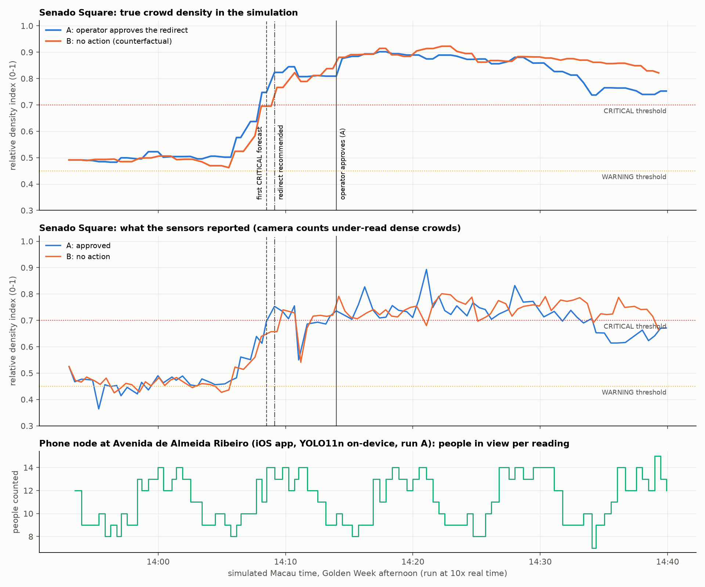

# End-to-end simulation run (no field test)

Recorded 2026-09-29 on one Mac. Everything a field test would exercise ran together, except a real camera pointed at real people in Macau.

| part | what stood in for reality |
|---|---|
| crowd | the Golden-Week scenario of the built-in simulator (`golden_week_demo`), at 10× speed |
| 9 fixed sensor nodes | simulated observations from that crowd |
| 1 phone | the iOS app in the iPhone 17 Pro Simulator, **video mode**: YOLO11n on-device on a CC0 street-crossing clip (Toronto), GPS set to Avenida de Almeida Ribeiro, posting real HTTP observations with wall-clock timestamps |
| operator | a script driving the real dashboard in headless Chrome: opens Interventions, clicks VIEW EVIDENCE, clicks APPROVE |

Two runs on fresh databases with the final code, identical except for the operator:

- **Run A:** the operator approves the Senado Square redirect when it is recommended.
- **Run B:** the operator takes no action (counterfactual).

## Result



| measure | A: approved | B: no action |
|---|---|---|
| first CRITICAL forecast (any horizon, incl. low confidence) | 14:08:30 | 14:08:06 |
| first confident CRITICAL forecast (≥ 60%) | 14:09:08 | 14:13:14 |
| first CRITICAL reading from the sensors | 14:09:08 | 14:09:48 |
| first time the true density crossed CRITICAL | 14:08:09 | 14:09:20 |
| redirect recommended | 14:09:08 | 14:09:48 |
| operator approved | 14:14:00 | never |
| peak true density after approval time | 0.90 | 0.92 |
| minutes with true density ≥ CRITICAL | 32 | 31 |
| true density at end of run (14:40) | 0.75 | 0.82 |
| backend refresh time, median / max (ms) | 847 / 1333 | 805 / 1062 |
| phone node online (share of samples) | 99% | 99% |

Times are simulated Macau time. Generated by `experiments/simulation_figures.py` from `A_timeline.csv` / `B_timeline.csv` and `A_events.json` / `B_events.json`. The timelines sample every ~3 real seconds (~30 simulated seconds), so the times above are accurate to about ±30 s, and short-lived forecasts between samples are missed (in run B the redirect was created from a 61% forecast that fell between two samples).

What this shows:

- **The whole chain works together.** Phone → anonymous metadata → backend → zone state on the map → forecast with confidence → explanation → human-review flag → recommendation → operator approval in the UI → audit log → effect on the crowd. The phone's readings were accepted (HTTP 202), assigned to Almeida Ribeiro, and counted as a second sensor there; it was online in 99% of samples.
- **Approving the redirect lowers the crowd, modestly.** In run A Senado's true density fell from 0.90 to 0.75 over 25 minutes after approval; in run B it ended at 0.82. An earlier pair of runs with the same scenario (before the final review fixes) ended at 0.73 vs 0.87. In neither pair did Senado drop back below CRITICAL within the run (32 vs 31 minutes above it). The effect is a configurable prototype assumption, not a measured one: on approval the simulator makes routes into Senado 30% less attractive for 20 minutes (14:14–14:34 in run A, so the 14:40 values come after it ended); people re-choose among the other routes, so Senado's inflow falls by less than 30%. Time above CRITICAL was not shortened.
- **No early warning in this scenario.** The first CRITICAL forecast came within about a minute of the true density crossing CRITICAL: 21 s after it in run A, 74 s before it in run B (at 48% confidence, flagged for review). The demo crowd builds up in about 3 minutes (an event ending plus tour-group surges), faster than the forecast horizons can add value. The 5–15 minute lead measured offline (`ml/models/metrics.json`) is not demonstrated by this run.
- **Uncertain forecasts are flagged, and escalation follows confidence.** In run A the first CRITICAL forecast (14:08:30) had 49% effective confidence and was shown as LOW CONFIDENCE — HUMAN REVIEW REQUIRED, while a "Deploy staff" recommendation was pending. At 14:09:08 the forecasts reached 64–69%, and the redirect replaced the staff recommendation. Later forecasts dipped back to 50–54% and were flagged again.
- **The recommended route depends on which inflow dominates at that minute.** Both final runs targeted the north-eastbound tour-group flow from Almeida Ribeiro. Earlier runs of the same scenario sometimes targeted the southbound flow from St. Dominic's Square. Both inflows exist in the scenario.
- **Camera under-counting is visible.** Sensors reported about 0.70–0.80 while the true density was 0.85–0.92.
- **Restart and stop work on a used database** (checked after run B): a restart showed only the new run's alerts and recommendations with the clock back at 13:53; a stop emptied the zones, set the simulated sensors offline and left the phone online on the real clock.

## Files

| file | content |
|---|---|
| `simulation_run_timeline.png`, `summary_table.md` | figure and table above |
| `A01`–`A13_*.png` | dashboard screenshots from run A, in order: overview, live map, reliability (phone node listed), Almeida Ribeiro with the phone, Senado CRITICAL forecast with reasons, alerts, intervention with evidence, after approval with audit log, Senado after approval, AI explanation, evaluation, privacy, reliability at the end |
| `B05_zone_senado_critical_forecast.png` | run B at the first CRITICAL forecast |
| `A_timeline.csv`, `B_timeline.csv` | per-sample recording: observed and true density, state, forecasts and confidence, phone status and count, pending recommendations, refresh time |
| `A_events.json`, `B_events.json` | what happened when (screenshots, UI clicks, decisions) |
| `ios_app_live_detection.png`, `ios_app_video_mode_30s.mp4` | the iOS app counting people in video mode (green boxes are on-screen only) |
| `ios_app_debug_payload.png` | the exact JSON the phone sent: numbers only, wall-clock timestamp, while the server reply shows simulated time |
| `ios_app_offline_buffering.png` | the phone buffering readings while the backend was down; they were delivered when it came back |

The three `ios_app_*` images and the clip were taken during earlier runs with the same setup on the same day, not during run A.

## Reproduce

1. Build and launch the iOS app in the Simulator (see `docs/testing.md` section 1), set the Simulator location to Avenida de Almeida Ribeiro, and in the app choose Mode Video, Detector YOLO11n, then Start.

```bash
xcrun simctl location booted set 22.19282,113.53925
```

2. Start a dashboard (production build) on port 3100 and a backend on a fresh database at 10× speed:

```bash
cd dashboard && node node_modules/next/dist/bin/next build && node node_modules/next/dist/bin/next start -p 3100
```

```bash
CROWDPULSE_DATABASE_URL=sqlite:///run_a.db CROWDPULSE_CORS_ORIGINS=http://localhost:3100 CROWDPULSE_SIM_ACCELERATION=10 .venv/bin/uvicorn backend.app.main:app --host 0.0.0.0 --port 8000
```

3. Start headless Chrome, then the run (about 5 real minutes). Set `CROWDPULSE_PHONE_NODE` to the node id shown on the app's Setup page.

```bash
.venv/bin/python experiments/simulation_harness/cdp.py start
```

```bash
CROWDPULSE_PHONE_NODE=node-a3cd4a .venv/bin/python experiments/simulation_harness/run_sim.py --tag A --out experiments/results/simulation_run --end 14:40
```

4. For run B restart the backend on another fresh database and add `--no-approve --shots minimal --tag B`. Then build the figure:

```bash
PYTHONPATH=. .venv/bin/python experiments/simulation_figures.py
```

Keep the Mac awake during a run: the simulated clock pauses while it sleeps and the run then times out.
